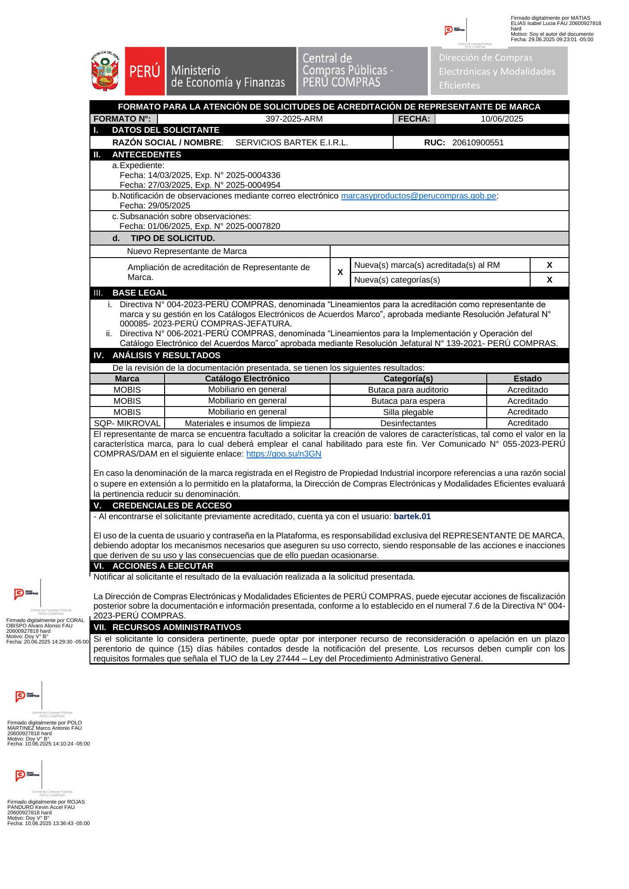
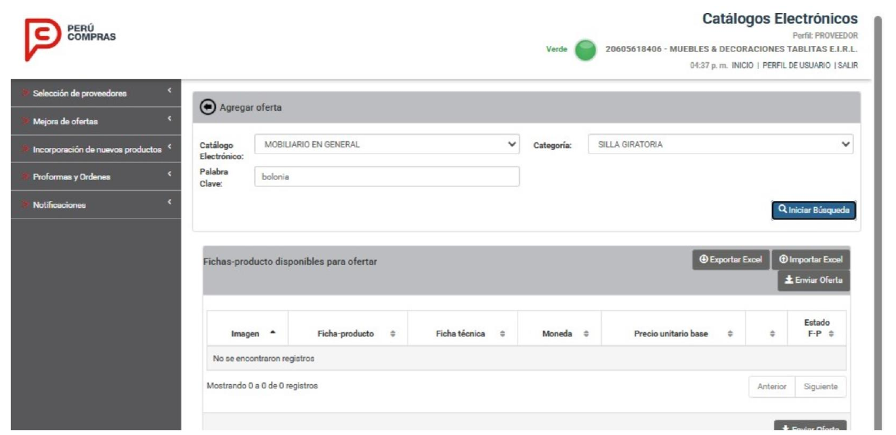
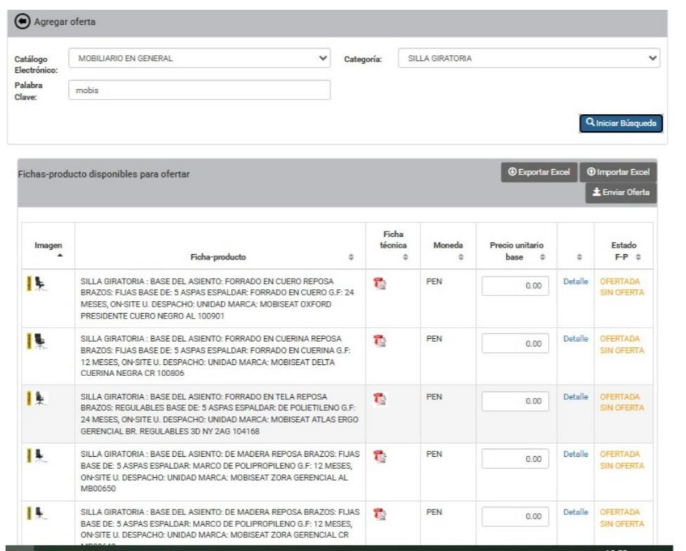
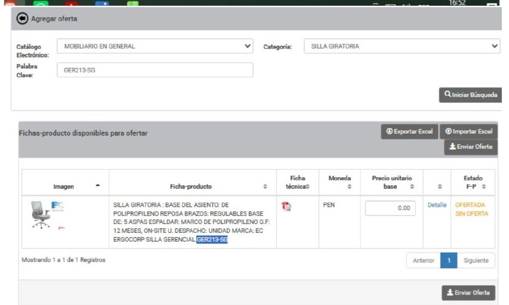

Lima, 16 de octubre de 2026

**CARTA N.° 16102026-1-SERVICIOS BARTEK E.I.R.L.**

Señor
**NEAL MARTÍN MAURA GONZALES**
Director de la Dirección de Compras Electrónicas y Modalidades Eficientes – DCEME
Central de Compras Públicas – **PERÚ COMPRAS**
Av. República de Panamá N.° 3629, San Isidro, Lima
Presente.–

**ASUNTO:** SE REITERA PEDIDO DE HABILITACIÓN INMEDIATA de las 22 Fichas-Producto de la marca **MOBIS** en estado OFERTADO y se solicita la formalización del Acuerdo de Adhesión de SERVICIOS BARTEK E.I.R.L.

**REFERENCIAS:**

a) Nuestra carta del 07 de octubre de 2026 y reclamo en el Libro de Reclamaciones, código **pp4c2lqjm**.
b) Respuesta de su Dirección a nuestro pedido, recibida en octubre de 2026.
c) Formato N.° 397-2025-ARM, del 10 de junio de 2025.
d) Resolución Jefatural N.° 000087-2026-PERÚ COMPRAS-JEFATURA, del 22 de julio de 2026.

---

De nuestra consideración:

**SERVICIOS BARTEK E.I.R.L.**, con RUC N.° **20610900551**, representada por su Gerente, **FAVIOLA ORIHUELA PIMENTEL**, identificada con DNI N.° **10790531**, se dirige a su Dirección en relación con su respuesta de la referencia b), que **no resuelve el problema** que planteamos.

## 1. LO QUE SU DIRECCIÓN RECONOCE

En su respuesta, su Dirección confirma que:

- Nuestra empresa está **acreditada** como representante de la marca MOBIS desde el **10 de junio de 2025** (Formato N.° 397-2025-ARM).
- Tenemos **22 Fichas-Producto en estado OFERTADO**, **incorporadas con anterioridad** en el Catálogo Electrónico de Mobiliario en General.
- **Cumplimos con presentar el Acuerdo de Adhesión** y sus anexos, y su formalización **está pendiente de PERÚ COMPRAS**.
- **Por esa razón**, los proveedores no pueden ofertar nuestras fichas.

## 2. POR QUÉ ESA EXPLICACIÓN NO ES SUFICIENTE

**2.1. Nuestras fichas existían antes del Acuerdo de Adhesión.** El formato de Acuerdo de Adhesión se aprobó con la **Resolución Jefatural N.° 000087-2026-PERÚ COMPRAS-JEFATURA**, del **22 de julio de 2026**, y se comunicó con el **Comunicado N.° 040-2026-PERÚ COMPRAS**, del **24 de julio de 2026**. Nuestras 22 fichas ya estaban en estado OFERTADO **mucho antes de esa fecha**. Sin embargo, los proveedores **no han podido verlas ni ofertarlas**. Un requisito creado en julio de 2026 **no puede explicar** que nuestras fichas no fueran visibles antes.

**2.2. La norma no ordena bloquear fichas ya ofertadas.** La Resolución Jefatural N.° 000087-2026 solo **aprueba el formato** del Acuerdo de Adhesión (artículo primero) y autoriza a su Dirección a **difundir los plazos para suscribirlo** (artículo segundo). **No dispone** que las fichas ya incorporadas y ofertadas dejen de estar disponibles mientras el acuerdo se formaliza. Por su parte, el **artículo 276.1 del Reglamento de la Ley N.° 32069** exige al representante de marca mantener las condiciones que motivaron su acreditación, y nuestra empresa **las mantiene**.

**2.3. El Comunicado N.° 080-2025 no aplica a nuestras fichas.** Según su propia respuesta, esa suspensión comprendió las fichas **"incorporadas, no ofertadas y no adjudicadas"**. Nuestras fichas están en estado **OFERTADO**, por lo que **no estaban comprendidas** en esa medida.

**2.4. El Comunicado N.° 022-2026 tampoco aplica.** Ese cronograma era para registrar **nuevas** fichas. Nuestro reclamo **no es sobre fichas nuevas**, sino sobre las **22 fichas que ya existen** y que su Dirección reconoce como incorporadas.

**2.5. El Acuerdo de Adhesión es uno solo y es de SERVICIOS BARTEK E.I.R.L.** El Acuerdo lo suscribe **nuestra empresa** como representante de marca, **no cada marca por separado**. Nuestras fichas de **aceite vegetal**, incorporadas **después** que las de MOBIS, dependen del **mismo Acuerdo de Adhesión**. Si ese trámite pendiente impide ofertar, debe afectar por igual a todas nuestras marcas. Si no las afecta, **la falta de formalización no es la causa** de que las fichas MOBIS no se vean, y su Dirección debe informarnos la causa real.

**2.6. La demora es de PERÚ COMPRAS, no nuestra.** Según el **literal b) del numeral 9.1.2 de la Directiva N.° 005-2025-PERÚ COMPRAS (Versión 2)**, aprobada por Resolución Jefatural-D N.° 000096-2025-PERÚ COMPRAS-JEFATURA, la formalización del Acuerdo de Adhesión **corresponde a su Dirección, previa autorización de la Jefatura de PERÚ COMPRAS**. Es decir, **depende solo de la entidad**. PERÚ COMPRAS fijó como plazo para suscribir el Acuerdo de Adhesión el **31 de julio de 2026**, y de manera excepcional el **07 de agosto de 2026**. Nosotros cumplimos. Han pasado **más de dos meses** y la formalización sigue "en trámite", **sin plazo ni fecha**. Mientras tanto, nuestra empresa y los proveedores pierden periodos de oferta **por causas que no nos son imputables**.

**2.7. Se afectan los principios de la contratación pública.** Mantener bloqueadas fichas acreditadas y ofertadas, sin plazo, mientras las de otras marcas del mismo catálogo se ofertan con normalidad, vulnera los principios de **libertad de concurrencia, igualdad de trato y transparencia** de la **Ley N.° 32069, Ley General de Contrataciones Públicas**, y el **derecho de petición** (artículo 2, inciso 20 de la Constitución y **TUO de la Ley N.° 27444**).

## 3. LO QUE SOLICITAMOS

En un plazo **no mayor de cinco (5) días hábiles**:

1. **Formalizar el Acuerdo de Adhesión** de SERVICIOS BARTEK E.I.R.L. o, si falta algún documento, **indicarnos por escrito cuál**.
2. **Habilitar de inmediato las 22 Fichas-Producto de la marca MOBIS** en estado OFERTADO, para que los proveedores puedan ofertarlas.
3. **Otorgar un periodo extraordinario** de presentación de ofertas para nuestras fichas MOBIS, por los periodos perdidos por causas ajenas a nuestra empresa.
4. **Informarnos por escrito**:
   a) **Desde qué fecha** las 22 fichas MOBIS **no están habilitadas** para los proveedores.
   b) **Por qué** no fueron visibles **antes del 22 de julio de 2026**, fecha en que se aprobó el formato del Acuerdo de Adhesión.
   c) Si nuestras fichas de **otras marcas** dependen del mismo Acuerdo de Adhesión y, de ser así, **por qué reciben un trato distinto**.
   d) **La fecha estimada** de formalización de nuestro Acuerdo de Adhesión.

De no recibir respuesta en el plazo indicado, acudiremos al **Órgano de Control Institucional de PERÚ COMPRAS** y a la **Defensoría del Pueblo**, y nos reservamos el derecho de reclamar los **daños y perjuicios** ocasionados.

Atentamente,

&nbsp;

&nbsp;

\_\_\_\_\_\_\_\_\_\_\_\_\_\_\_\_\_\_\_\_\_\_\_\_\_\_\_\_\_\_\_\_\_\_\_
**FAVIOLA ORIHUELA PIMENTEL**
DNI N.° 10790531
Gerente
**SERVICIOS BARTEK E.I.R.L.** – RUC N.° 20610900551
Correo: serviciosbartek@gmail.com

---

**ANEXOS:**

- **Anexo 1:** Formato N.° 397-2025-ARM, del 10 de junio de 2025 (acreditación de la marca MOBIS).
- **Anexo 2:** Capturas de la plataforma (perfil proveedor): las fichas MOBIS no aparecen, mientras las de otras marcas sí.

```{=openxml}
<w:p><w:r><w:br w:type="page"/></w:r></w:p>
```

**ANEXO 1 – Formato N.° 397-2025-ARM (acreditación de la marca MOBIS)**

{width=16cm}

```{=openxml}
<w:p><w:r><w:br w:type="page"/></w:r></w:p>
```

**ANEXO 2 – Capturas de la plataforma (perfil proveedor)**

**2.1. Búsqueda de un modelo de la marca MOBIS: "No se encontraron registros".**

{width=12cm}

**2.2. Búsqueda "mobis": aparecen fichas de otra marca (MOBISEAT), pero no las de MOBIS.**

{width=8.5cm}

**2.3. Las fichas de otras marcas sí aparecen y se pueden ofertar.**

{width=8.5cm}
