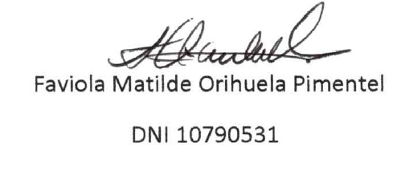
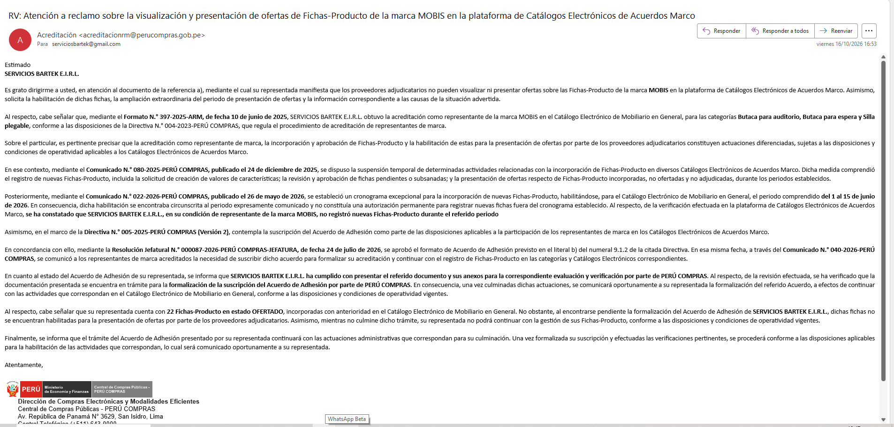
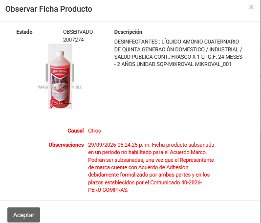
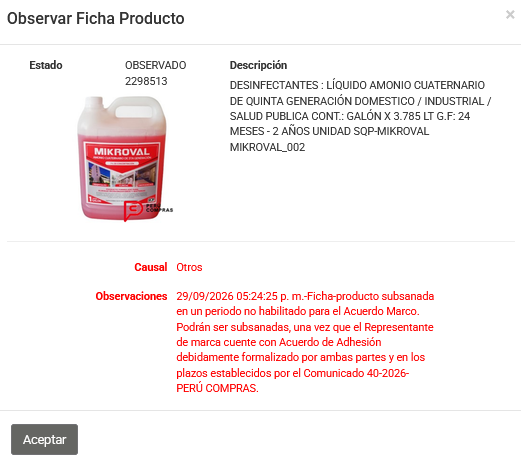
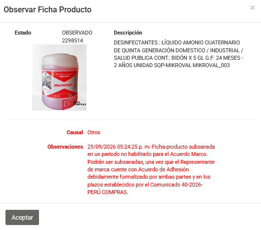

Lima, 26 de octubre de 2026

**SUMILLA: QUEJA POR DEFECTO DE TRAMITACIÓN**

Señor
**JORGE ALBERTO ZAPATA GALLO**
Jefe de la Central de Compras Públicas – **PERÚ COMPRAS**
Av. República de Panamá N.° 3629, San Isidro, Lima
Presente.–

**QUEJADO:** Dirección de Compras Electrónicas y Modalidades Eficientes – DCEME.

**REFERENCIAS:**

a) Carta N.° 16102026-1-SERVICIOS BARTEK E.I.R.L., del 16 de octubre de 2026 (Anexo 3).
b) Correo de la DCEME (acreditacionrm@perucompras.gob.pe) del 16 de octubre de 2026 (Anexo 1).
c) Reclamo en el Libro de Reclamaciones, código **pp4c2lqjm**, del 07 de octubre de 2026.

---

**SERVICIOS BARTEK E.I.R.L.**, con RUC N.° **20610900551**, representada por su Gerente, **FAVIOLA MATILDE ORIHUELA PIMENTEL**, identificada con DNI N.° **10790531**, presenta **QUEJA POR DEFECTO DE TRAMITACIÓN** contra la DCEME, conforme al **artículo 169 del TUO de la Ley N.° 27444**, Ley del Procedimiento Administrativo General, aprobado por Decreto Supremo N.° 004-2019-JUS, por la **paralización** del trámite de formalización de nuestro **Acuerdo de Adhesión**.

## 1. HECHOS

**1.1.** Somos representante de marca acreditado de las marcas **MOBIS** (Mobiliario en General) y **SQP-MIKROVAL** (Desinfectantes), según el **Formato N.° 397-2025-ARM**, del 10 de junio de 2025, así como de las marcas **DELISOYA** y **SRB**. El Acuerdo de Adhesión es **uno solo** y lo suscribe SERVICIOS BARTEK E.I.R.L. como representante de marca, por lo que su falta de formalización **afecta a todas nuestras marcas**.

**1.2.** Mediante el **Comunicado N.° 040-2026-PERÚ COMPRAS**, se requirió a los representantes de marca suscribir el Acuerdo de Adhesión **hasta el 31 de julio de 2026**, y de manera excepcional hasta el **07 de agosto de 2026**. **Cumplimos.**

**1.3.** La propia DCEME, en su correo del 16 de octubre de 2026 (Anexo 1), **reconoce** que:

- SERVICIOS BARTEK E.I.R.L. **cumplió con presentar el Acuerdo de Adhesión** y sus anexos.
- La formalización está **pendiente por parte de PERÚ COMPRAS**.
- Por esa razón, nuestras **22 Fichas-Producto MOBIS en estado OFERTADO** no están habilitadas para los proveedores, y no podemos gestionarlas.

**1.4.** Por el mismo motivo, nuestras **3 Fichas-Producto SQP-MIKROVAL** (N.° 2007274, 2298513 y 2298514) fueron **observadas** el 29 de septiembre de 2026 y solo podrán subsanarse cuando el Acuerdo de Adhesión esté *"debidamente formalizado por ambas partes"* (Anexo 2).

**1.5.** El 16 de octubre de 2026 remitimos la **Carta N.° 16102026-1** (Anexo 3), pidiendo la formalización y la habilitación de nuestras fichas en **cinco (5) días hábiles**. **El plazo venció sin respuesta.**

**1.6.** Han pasado **más de dos meses y medio** desde el plazo del 07 de agosto de 2026. La formalización sigue *"en trámite"*, **sin plazo ni fecha**.

## 2. DEBERES INFRINGIDOS

**2.1. Formalizar el Acuerdo de Adhesión le corresponde solo a PERÚ COMPRAS.** El **literal b) del numeral 9.1.2 de la Directiva N.° 005-2025-PERÚ COMPRAS (Versión 2)** dispone que la formalización la realiza la **DCEME, previa autorización de la Jefatura**. Nuestra empresa no puede hacer nada más.

**2.2. Los plazos obligan a la Administración.** El **artículo 142 del TUO de la Ley N.° 27444** establece que los plazos son **máximos** y **obligan por igual a la administración y a los administrados**. A falta de un plazo especial, el **artículo 39** fija un máximo de **treinta (30) días hábiles** para resolver. Contado desde el 07 de agosto de 2026, ese plazo **venció en septiembre de 2026**.

**2.3. Se vulnera el principio de celeridad** (numeral 1.9 del artículo IV del Título Preliminar del TUO de la Ley N.° 27444), que obliga a la autoridad a evitar actuaciones que dificulten su desenvolvimiento y a no dilatar el procedimiento.

**2.4. Se vulnera el derecho de petición** (artículo 2, inciso 20 de la Constitución), porque nuestra Carta N.° 16102026-1 no fue respondida.

**2.5. El perjuicio es directo y continuo.** Cada mes que pasa, los proveedores no pueden ofertar nuestras 22 fichas MOBIS ni podemos subsanar las 3 fichas SQP-MIKROVAL, **por una demora que no nos es imputable**. Según la propia DCEME, mientras no culmine el trámite **no podemos continuar con la gestión de nuestras Fichas-Producto**, lo que alcanza también a las marcas **DELISOYA** y **SRB**.

## 3. PETITORIO

Solicitamos a su Jefatura que, conforme al **artículo 169.2 del TUO de la Ley N.° 27444**, resuelva esta queja **dentro de los tres (3) días hábiles** siguientes y:

1. **Declare FUNDADA** la queja.
2. **Ordene a la DCEME formalizar de inmediato** el Acuerdo de Adhesión de SERVICIOS BARTEK E.I.R.L., otorgando la autorización que le corresponda a su Jefatura.
3. **Ordene habilitar** nuestras **22 Fichas-Producto MOBIS** para la presentación de ofertas, y **permitir de inmediato la subsanación** de las **3 fichas SQP-MIKROVAL**, sin esperar al siguiente periodo del cronograma, y **restablecer la gestión de las Fichas-Producto de todas nuestras marcas** (MOBIS, SQP-MIKROVAL, DELISOYA y SRB).
4. **Disponga un periodo extraordinario** de presentación de ofertas para nuestras fichas, por los periodos perdidos.
5. **Disponga el deslinde de responsabilidades** de los servidores a cargo del trámite, conforme al **artículo 261 del TUO de la Ley N.° 27444**, remitiendo lo actuado a la Secretaría Técnica de los Procedimientos Administrativos Disciplinarios.
6. **Ordene responder por escrito** nuestra Carta N.° 16102026-1.

Pondremos esta queja en conocimiento del **Órgano de Control Institucional de PERÚ COMPRAS** y de la **Defensoría del Pueblo**, y nos reservamos el derecho de reclamar los **daños y perjuicios** ocasionados (artículo 260 del TUO de la Ley N.° 27444).

Atentamente,

{width=5.5cm}

**SERVICIOS BARTEK E.I.R.L.** – RUC N.° 20610900551
Gerente: Faviola Matilde Orihuela Pimentel
Correo: serviciosbartek@gmail.com

**ANEXOS:**

- **Anexo 1:** Correo de la DCEME del 16 de octubre de 2026.
- **Anexo 2:** Observaciones del 29/09/2026 a las fichas SQP-MIKROVAL N.° 2007274, 2298513 y 2298514.
- **Anexo 3:** Carta N.° 16102026-1-SERVICIOS BARTEK E.I.R.L., con sus anexos.

```{=openxml}
<w:p><w:r><w:br w:type="page"/></w:r></w:p>
```

**ANEXO 1 – Correo de la DCEME del 16 de octubre de 2026**

{width=16.5cm}

**ANEXO 2 – Observaciones a las fichas SQP-MIKROVAL (29/09/2026)**

{width=5.4cm} {width=5.4cm} {width=5.4cm}
