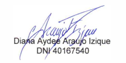

Lima, 26 de octubre de 2026

**CARTA N.° 26102026-01-IMPORTADORA DAXSA S.A.C.**

Señor
**NEAL MARTÍN MAURA GONZALES**
Director de la Dirección de Compras Electrónicas y Modalidades Eficientes – DCEME
Central de Compras Públicas – **PERÚ COMPRAS**
Av. República de Panamá N.° 3629, San Isidro, Lima
Presente.–

**ASUNTO:** REITERAMOS SOLICITUD de copia del documento de acreditación, confirmación de vigencia e indicaciones para registrar Fichas-Producto de la marca **FD FORESTALES DAXSA** – Acuerdo Marco **EXT-CE-2024-16**.

**REFERENCIAS:**

a) Carta N.° 09102026-01-IMPORTADORA DAXSA S.A.C., del 09 de octubre de 2026 – **Registro N.° S-2026-47807**.
b) Registro N.° S-2024-31367 (subsanación de la solicitud de acreditación, del 20/11/2024).

---

De nuestra consideración:

**IMPORTADORA DAXSA S.A.C.**, con RUC N.° **20611290757**, representada por su Gerente General, **DIANA AYDEE ARAUJO IZIQUE**, identificada con DNI N.° **40167540**, se dirige a su Dirección para **reiterar** la solicitud de la referencia a).

**1.** El **09 de octubre de 2026** solicitamos a su Dirección, en un plazo de diez (10) días hábiles:

- Copia del **Formato o documento de acreditación** de la marca FD FORESTALES DAXSA.
- La **confirmación de su vigencia** en el Acuerdo Marco **EXT-CE-2024-16 – Accesorios Domésticos y Bienes para Usos Diversos**.
- Los datos de nuestra **credencial de acceso** a la Plataforma.
- Las **indicaciones para registrar Fichas-Producto**.

**2.** Ese plazo **venció sin respuesta**.

**3.** Mediante el **Comunicado N.° 040-2026-PERÚ COMPRAS**, del 24 de julio de 2026, se dispuso que los representantes de marca acreditados deben **suscribir el Acuerdo de Adhesión** para formalizar su participación y el registro de Fichas-Producto. **No hemos recibido el Acuerdo de Adhesión** en nuestro correo. Si nuestra empresa está acreditada, necesitamos saber cómo suscribirlo.

Por ello, **SOLICITAMOS** que, en un plazo **no mayor de cinco (5) días hábiles**, su Dirección nos remita al correo **licitaciones@forestalesdaxsa.com.pe**:

1. La información pedida en nuestra Carta N.° 09102026-01.
2. El **Acuerdo de Adhesión** para su suscripción o, si no corresponde, el motivo.

Formulamos esta reiteración en ejercicio del **derecho de petición** (artículo 2, inciso 20 de la Constitución Política del Perú) y conforme al **TUO de la Ley N.° 27444**, Ley del Procedimiento Administrativo General. Agradecemos de antemano su pronta atención.

Atentamente,

{width=5.5cm}

**DIANA AYDEE ARAUJO IZIQUE**
DNI N.° 40167540
Gerente General
**IMPORTADORA DAXSA S.A.C.** – RUC N.° 20611290757
Correo: licitaciones@forestalesdaxsa.com.pe · Celular: 986045123

**ANEXO:**

- **Anexo 1:** Carta N.° 09102026-01-IMPORTADORA DAXSA S.A.C. (Registro N.° S-2026-47807), con sus anexos.
