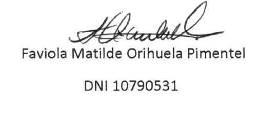
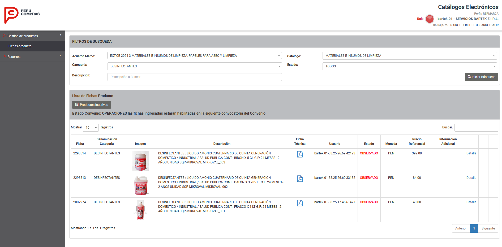
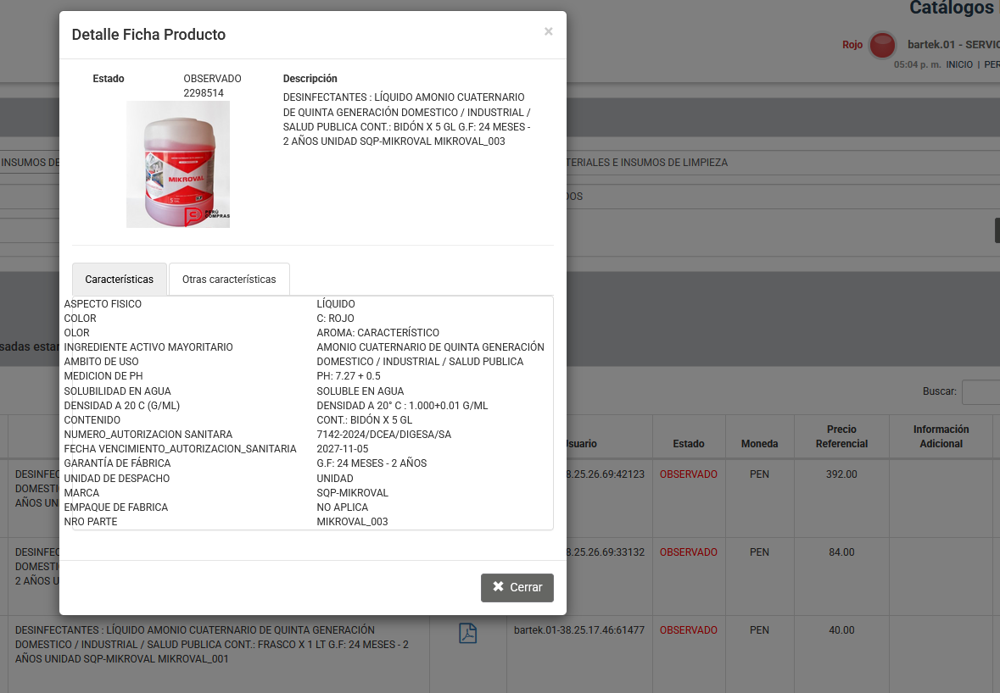

Lima, 01 de diciembre de 2026

**CARTA N.° 01122026-1-SERVICIOS BARTEK E.I.R.L.**

Señor
**JORGE ALBERTO ZAPATA GALLO**
Jefe de la Central de Compras Públicas – **PERÚ COMPRAS**
Av. República de Panamá N.° 3629, San Isidro, Lima
Presente.–

**ASUNTO:** AMPLIACIÓN DE QUEJA POR DEFECTO DE TRAMITACIÓN (Exp. N.° 2026-0009479) – **URGENTE**. El Acuerdo de Adhesión de SERVICIOS BARTEK E.I.R.L. fue formalizado el 20/11/2026, pero PERÚ COMPRAS solo registró una de sus ocho categorías, y las Fichas-Producto MOBIS siguen sin habilitarse en el periodo de ofertas del 01 al 09/12/2026.

**REFERENCIAS:**

a) Queja por defecto de tramitación, Carta N.° 26102026-1 – **Exp. N.° 2026-0009479**, del 26/10/2026, **no resuelta**.
b) Carta N.° 03112026-1 al Órgano de Control Institucional – **Exp. N.° 2026-0009847**, del 05/11/2026.
c) Acuerdo de Adhesión de SERVICIOS BARTEK E.I.R.L., **formalizado el 20/11/2026** (Anexo 3).
d) Correos a acreditacionrm@perucompras.gob.pe del 23/11/2026 y del 25/11/2026, sin respuesta.

**SERVICIOS BARTEK E.I.R.L.**, con RUC N.° **20610900551**, representada por su Gerente, **FAVIOLA MATILDE ORIHUELA PIMENTEL**, identificada con DNI N.° **10790531**, **amplía** la queja de la referencia a), conforme al **artículo 169 del TUO de la Ley N.° 27444**, por los siguientes hechos nuevos:

**1. El acuerdo se formalizó, pero de forma incompleta.** El 20/11/2026 el Director de la DCEME firmó nuestro Acuerdo de Adhesión, cuyo **Anexo** comprende **ocho categorías**: **MOBIS** (silla fija, silla giratoria, butaca para auditorio, butaca para espera y silla plegable), **SQP-MIKROVAL** (desinfectantes), **SRB** (neumáticos para vehículos pesados) y **DELISOYA** (aceite vegetal) (Anexo 3).

**2. PERÚ COMPRAS solo registró una categoría.** En el **listado oficial de Representantes de Marca con Acuerdo de Adhesión** publicado por PERÚ COMPRAS (consulta del 25/11/2026), SERVICIOS BARTEK E.I.R.L. figura **únicamente con DELISOYA**. **No figuran MOBIS, SQP-MIKROVAL ni SRB** (Anexo 1).

**3. Consecuencia: las fichas siguen bloqueadas.** Por ese error de registro:

- Nuestras **22 Fichas-Producto MOBIS** en estado OFERTADO **siguen sin estar habilitadas** para los proveedores en el periodo de presentación de ofertas que **comenzó hoy, 01/12/2026**.
- La plataforma **no nos permite subsanar** las fichas SQP-MIKROVAL N.° 2007274, 2298513 y 2298514, pese a que la observación indicaba que podrían subsanarse una vez formalizado el acuerdo (Anexo 2). El periodo habilitado venció el 30/11/2026.

**4. Lo advertimos a tiempo y no hubo respuesta.** Comunicamos el problema a la DCEME por correo el **23/11/2026** y el **25/11/2026**, con el listado oficial y las capturas de la plataforma. **No hubo respuesta ni corrección.**

**5. La demora no es imputable a nuestra empresa.** Suscribimos el acuerdo el mismo día en que nos fue remitido (31/07/2026), subsanamos dentro de plazo cada observación y lo suscribimos nuevamente por el cambio de titular de la DCEME. Han transcurrido **cuatro meses** de bloqueo, en contravención del **artículo 142** (obligatoriedad de los plazos) y del **principio de celeridad** del TUO de la Ley N.° 27444.

**SOLICITAMOS** a su Jefatura que, en el plazo de **tres (3) días hábiles** (artículo 169.2 del TUO de la Ley N.° 27444):

1. **Resuelva** la queja (Exp. N.° 2026-0009479) y su ampliación, declarándolas **FUNDADAS**.
2. **Ordene a la DCEME registrar todas las categorías** del Anexo de nuestro Acuerdo de Adhesión (MOBIS, SQP-MIKROVAL y SRB).
3. **Ordene habilitar de inmediato** nuestras **22 Fichas-Producto MOBIS** y otorgar un **periodo extraordinario** para que los proveedores puedan ofertarlas, en compensación de los periodos perdidos.
4. **Ordene habilitar de inmediato la subsanación** de las fichas SQP-MIKROVAL N.° 2007274, 2298513 y 2298514, fuera del cronograma ordinario, por tratarse de un error imputable a la Entidad.
5. **Disponga el deslinde de responsabilidades** de los servidores a cargo (artículo 261 del TUO de la Ley N.° 27444).

Pondremos esta ampliación en conocimiento del **Órgano de Control Institucional de PERÚ COMPRAS** (Exp. N.° 2026-0009847) y de la **Defensoría del Pueblo**, y nos reservamos el derecho de reclamar los **daños y perjuicios** ocasionados.

Atentamente,

{width=4.8cm}

**SERVICIOS BARTEK E.I.R.L.** – RUC N.° 20610900551 · Correo: serviciosbartek@gmail.com

**ANEXOS:**

- **Anexo 1:** Extracto del listado oficial de Representantes de Marca con Acuerdo de Adhesión (consulta del 25/11/2026).
- **Anexo 2:** Capturas de la plataforma: fichas SQP-MIKROVAL observadas y sin opción de subsanar.
- **Anexo 3:** Acuerdo de Adhesión formalizado el 20/11/2026.

```{=openxml}
<w:p><w:r><w:br w:type="page"/></w:r></w:p>
```

**ANEXO 1 – Listado oficial de Representantes de Marca con Acuerdo de Adhesión (consulta del 25/11/2026)**

Fuente: PERÚ COMPRAS, central.perucompras.gob.pe/acuerdos-marco/representante-marca-acuerdo-adhesion.php – archivo exportado *representantes_marca_2026-11-25* (1,435 registros, 167 representantes de marca).

**Registros de SERVICIOS BARTEK E.I.R.L. (RUC 20610900551):**

| Acuerdo Marco | Catálogo Electrónico | Categoría | Marca |
|---|---|---|---|
| EXT-CE-2024-18 | Aceite y grasas | Aceite vegetal | DELISOYA |

**Categorías del Anexo de nuestro acuerdo formalizado que NO figuran en el listado:**

| Marca | Catálogo Electrónico | Categoría |
|---|---|---|
| MOBIS | Mobiliario en General | Silla fija |
| MOBIS | Mobiliario en General | Silla giratoria |
| MOBIS | Mobiliario en General | Butaca para auditorio |
| MOBIS | Mobiliario en General | Butaca para espera |
| MOBIS | Mobiliario en General | Silla plegable |
| SQP-MIKROVAL | Materiales e Insumos de Limpieza | Desinfectantes |
| SRB | Llantas, Neumáticos y Accesorios | Neumáticos vehículos pesados |

```{=openxml}
<w:p><w:r><w:br w:type="page"/></w:r></w:p>
```

**ANEXO 2 – Plataforma de Catálogos Electrónicos (23/11/2026): fichas SQP-MIKROVAL en estado OBSERVADO y sin opción de subsanar**

{width=16cm}

{width=12cm}
