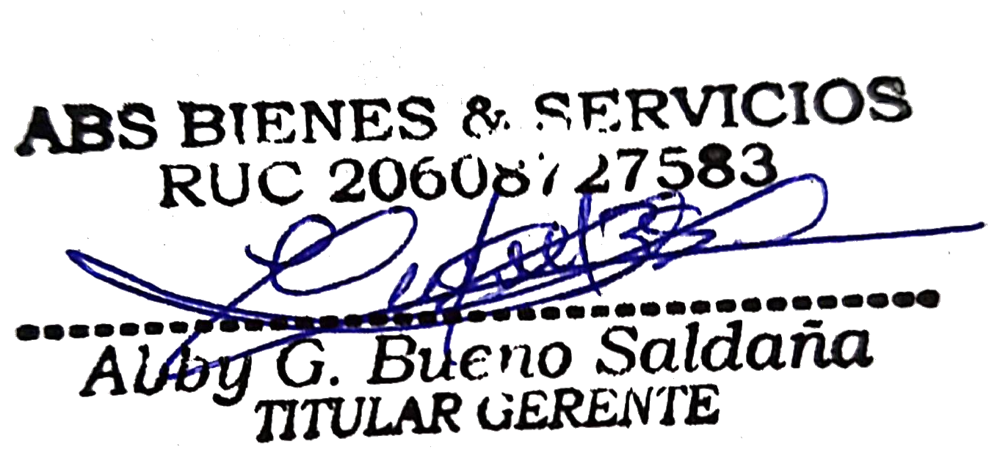
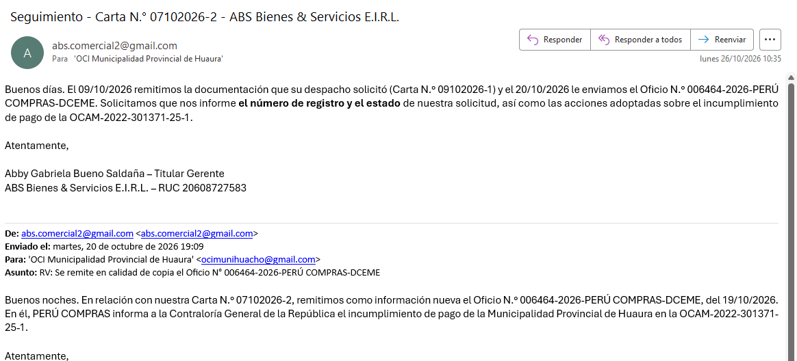
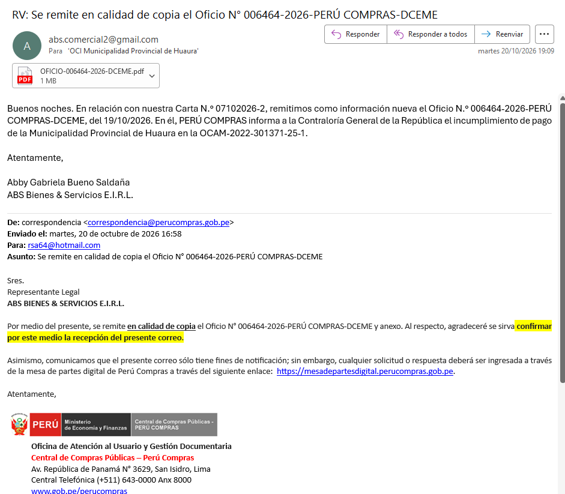

Lima, 03 de noviembre de 2026

**CARTA N.° 03112026-1-ABS BIENES & SERVICIOS E.I.R.L.**

Señores
**CONTRALORÍA GENERAL DE LA REPÚBLICA**
Jr. Camilo Carrillo N.° 114, Jesús María, Lima
Presente.–

**ASUNTO:** SOLICITUD DE INFORMACIÓN SOBRE EL ESTADO DE NUESTRA DENUNCIA Y DE INTERVENCIÓN ante la falta de atención del Órgano de Control Institucional de la Municipalidad Provincial de Huaura – Huacho – Orden de Compra N.° 000146 / **OCAM-2022-301371-25-0 y 25-1** (S/ 5,223.39).

**REFERENCIAS:**

a) Carta N.° 07102026-4-ABS BIENES & SERVICIOS E.I.R.L. (denuncia), presentada el 07/10/2026, 18:43.
b) **Oficio N.° 006464-2026-PERÚ COMPRAS-DCEME**, del 19/10/2026, dirigido a su institución.
c) Oficio N.° 003413-2026-PERÚ COMPRAS-DCEME, del 21/07/2026, dirigido al OCI de la Municipalidad Provincial de Huaura.
d) Cartas N.° 07102026-2 y N.° 09102026-1 al OCI de la Municipalidad Provincial de Huaura (09/10/2026) y correos de seguimiento del 20/10/2026 y 26/10/2026.

De nuestra consideración:

**ABS BIENES & SERVICIOS E.I.R.L.**, con RUC N.° **20608727583**, representada por su Titular Gerente, **ABBY GABRIELA BUENO SALDAÑA**, identificada con DNI N.° **48054321**, se dirige a su institución en relación con la denuncia de la referencia a).

**1.** La **Municipalidad Provincial de Huaura** adeuda a nuestra empresa **S/ 5,223.39** por la Orden de Compra N.° 000146 (OCAM-2022-301371-25-0 y 25-1), formalizada el **06/07/2022** y entregada. Más de cuatro años después, **no ha pagado**.

**2.** **PERÚ COMPRAS** verificó en la Plataforma de Catálogos Electrónicos que la orden registra el estado **"ENTREGADA C/CONFORMIDAD RETRASADA"** y, mediante el **Oficio N.° 006464-2026-PERÚ COMPRAS-DCEME** del 19/10/2026, **informó a su institución** el incumplimiento, conforme al literal e) del numeral 9.6 de la Directiva N.° 005-2025-PERÚ COMPRAS. Previamente, con el Oficio N.° 003413-2026, del 21/07/2026, había trasladado los mismos hechos al **OCI de la Municipalidad**.

**3.** El **numeral 67.4 del artículo 67 de la Ley N.° 32069** establece que constituye **falta grave** de la autoridad de gestión administrativa el incumplimiento, la negación o la demora injustificada del pago al contratista que cuenta con conformidad.

**4.** El **OCI de la Municipalidad Provincial de Huaura** nos solicitó documentación, que remitimos el **09/10/2026**. Desde entonces, y pese a nuestros correos del **20/10/2026** y **26/10/2026**, **no nos ha informado el número de registro ni el estado** de nuestra solicitud, ni las acciones adoptadas.

**5.** El caso también se encuentra en la **Defensoría del Pueblo** (Exp. N.° 000304-2026), que requirió información al Alcalde mediante el Oficio N.° 0308-2026-DP/OD-LIMAPROV.

**SOLICITAMOS** a su institución que:

1. Nos informe el **número de registro y el estado** de nuestra denuncia de la referencia a).
2. **Disponga las acciones de control** que correspondan sobre el incumplimiento de pago de la Municipalidad Provincial de Huaura, considerando lo informado por PERÚ COMPRAS en el Oficio N.° 006464-2026.
3. **Requiera al OCI de la Municipalidad Provincial de Huaura** información sobre la atención de nuestra solicitud y, de ser el caso, **asuma directamente** la evaluación de los hechos.

Atentamente,

{width=6cm}

**ABBY GABRIELA BUENO SALDAÑA**
DNI N.° 48054321 · Titular Gerente
**ABS BIENES & SERVICIOS E.I.R.L.** – RUC N.° 20608727583
Correo: abs.comercial2@gmail.com · Celular: 986045123

**ANEXOS:**

- **Anexo 1:** Correos al OCI de la Municipalidad Provincial de Huaura del 20/10/2026 y 26/10/2026.
- **Anexo 2:** Oficio N.° 006464-2026-PERÚ COMPRAS-DCEME, del 19/10/2026.

```{=openxml}
<w:p><w:r><w:br w:type="page"/></w:r></w:p>
```

**ANEXO 1 – Correos al OCI de la Municipalidad Provincial de Huaura**

{width=15cm}

{width=13cm}
