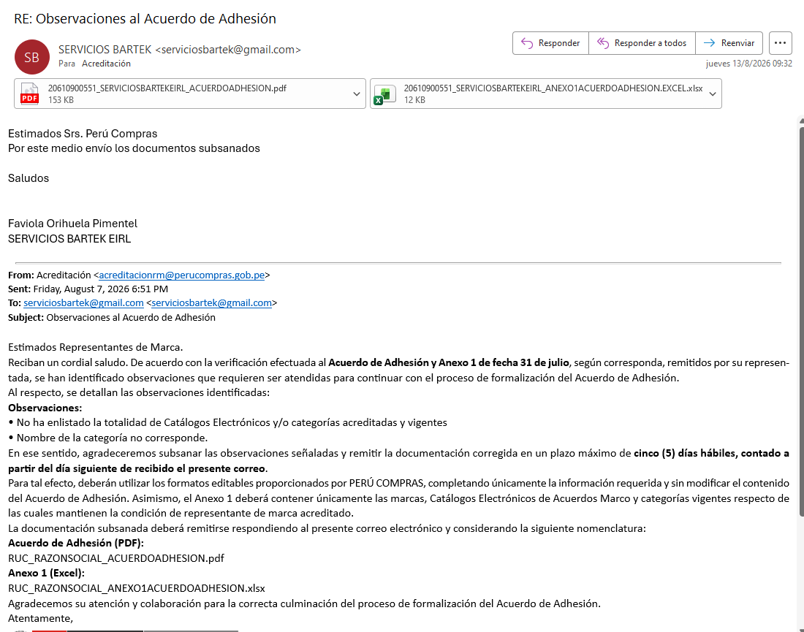
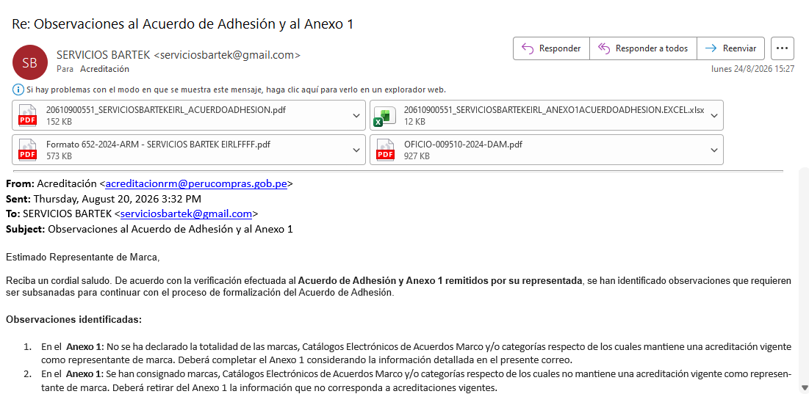
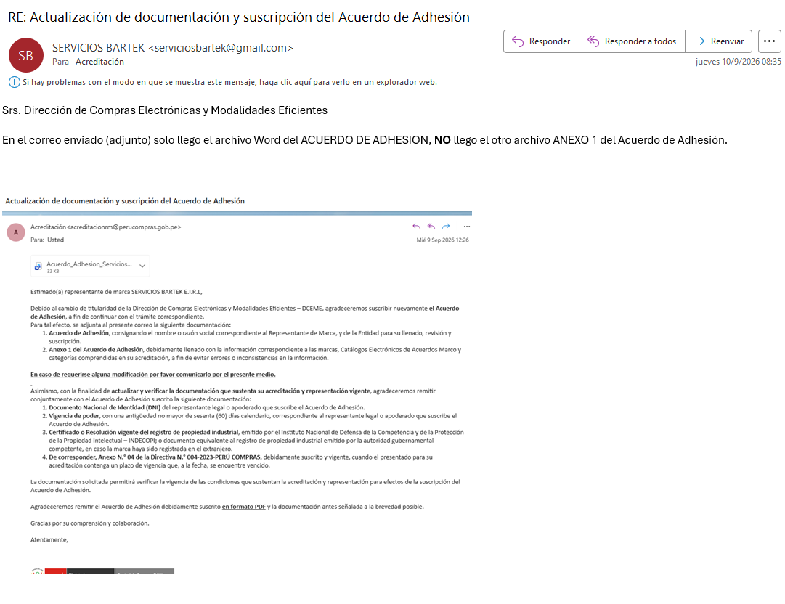
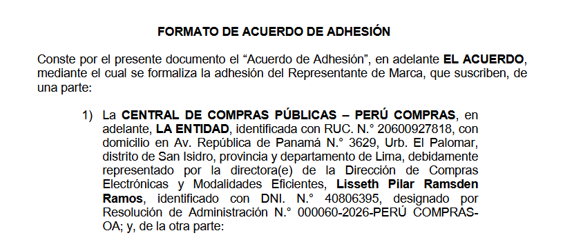
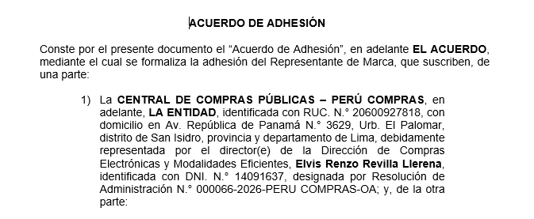
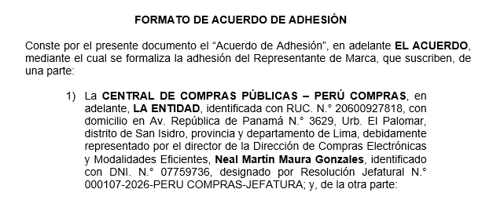

Lima, 03 de noviembre de 2026

**CARTA N.° 03112026-1-SERVICIOS BARTEK E.I.R.L.**

Señor(a)
**JEFE(A) DEL ÓRGANO DE CONTROL INSTITUCIONAL**
Central de Compras Públicas – **PERÚ COMPRAS**
Av. República de Panamá N.° 3629, San Isidro, Lima
Presente.–

**ASUNTO:** SOLICITUD DE INTERVENCIÓN URGENTE – Queja por defecto de tramitación **no resuelta** (Exp. N.° 2026-0009479) y paralización de la formalización del Acuerdo de Adhesión de SERVICIOS BARTEK E.I.R.L., durante el periodo de ofertas del 01 al 09 de noviembre de 2026.

**REFERENCIAS:**

a) Carta N.° 26102026-1-SERVICIOS BARTEK E.I.R.L. (queja por defecto de tramitación) – Solicitud **S-2026-48175**, **Exp. N.° 2026-0009479**, del 26/10/2026.
b) Carta N.° 16102026-1-SERVICIOS BARTEK E.I.R.L., del 16/10/2026.
c) Reclamo en el Libro de Reclamaciones, código **pp4c2lqjm**, del 07/10/2026, y Memorando N.° 001922-2026-PERÚ COMPRAS-DCEME, del 29/10/2026.

De nuestra consideración:

**SERVICIOS BARTEK E.I.R.L.**, con RUC N.° **20610900551**, representada por su Gerente, **FAVIOLA MATILDE ORIHUELA PIMENTEL**, identificada con DNI N.° **10790531**, pone en conocimiento de su despacho los siguientes hechos, para que, en el marco de sus competencias, **evalúe las acciones de control** que correspondan.

**1.** Nuestra empresa **cumplió cada paso del trámite dentro de los plazos** que fijó la propia DCEME (Anexo 1):

| Fecha | PERÚ COMPRAS (DCEME) | SERVICIOS BARTEK E.I.R.L. |
|---|---|---|
| 31/07/2026 | 10:34 – Remite el Acuerdo de Adhesión | **15:33 – Lo devuelve suscrito (mismo día)** |
| 07/08/2026 | Formula observaciones (5 días hábiles) | **13/08/2026 – Subsana (dentro del plazo)** |
| 20/08/2026 | Formula nuevas observaciones al Anexo 1 | **24/08/2026 – Subsana (dentro del plazo)** |
| 09/09/2026 | Pide **suscribir nuevamente** el acuerdo **por el cambio de titularidad de la DCEME** | **10/09/2026** – Advierte que no llegó el Anexo 1 |

La nueva suscripción **no se debió a un error nuestro**, sino a **cambios internos de PERÚ COMPRAS**: el formato del acuerdo que se nos remitió cambió **tres veces de firmante** por parte de la Entidad: la directora (e) **Lisseth Pilar Ramsden Ramos** (R.A. N.° 000060-2026-PERÚ COMPRAS-OA), el director (e) **Elvis Renzo Revilla Llerena** (R.A. N.° 000066-2026-PERÚ COMPRAS-OA) y el director **Neal Martín Maura Gonzales** (R.J. N.° 000107-2026-PERÚ COMPRAS-JEFATURA) (Anexo 1.5). La parte del acuerdo es **la Entidad**, no la persona que la representa: los cambios de su personal **no pueden trasladarse al administrado** ni reiniciar el trámite, conforme al principio de **predictibilidad o confianza legítima** (numeral 1.15 del artículo IV del Título Preliminar del TUO de la Ley N.° 27444). Según el Memorando N.° 001922-2026-DCEME, nuestra documentación está presentada desde el **14/09/2026** y la formalización está **pendiente por parte de PERÚ COMPRAS**. Aun contando desde el 14/09/2026, el plazo máximo de **treinta (30) días hábiles** del **artículo 39 del TUO de la Ley N.° 27444** **venció el 27/10/2026**. Mientras tanto, nuestras **22 Fichas-Producto MOBIS** en estado OFERTADO no están habilitadas para los proveedores, y nuestras **3 fichas SQP-MIKROVAL** no pueden subsanarse.

**2.** Según el **listado oficial** publicado por PERÚ COMPRAS, actualizado al 22/10/2026, la Entidad **ya formalizó el acuerdo de 24 representantes de marca** del Catálogo de Mobiliario en General y de **5** de la categoría Desinfectantes, en las mismas categorías que la nuestra. **El nuestro no.**

**3.** El **26/10/2026** presentamos **queja por defecto de tramitación** ante la Jefatura (Exp. N.° 2026-0009479). Conforme al **artículo 169.2 del TUO de la Ley N.° 27444**, debía resolverse **dentro de los tres (3) días hábiles**, es decir, **hasta el 29/10/2026**. **A la fecha no ha sido resuelta.**

**4.** El periodo de presentación de ofertas de los proveedores **ya comenzó (01 al 09 de noviembre de 2026)** y nuestras fichas **siguen sin estar habilitadas**. Cada día que pasa es un perjuicio directo para nuestra empresa y una restricción a la libre concurrencia en el catálogo.

**SOLICITAMOS** a su despacho que:

1. **Evalúe las acciones de control o preventivas** que correspondan ante la **falta de resolución de la queja** dentro del plazo legal y la **paralización** del trámite de formalización de nuestro Acuerdo de Adhesión.
2. **Verifique** el criterio seguido por la DCEME para formalizar los Acuerdos de Adhesión de otros representantes de marca del mismo catálogo y no el nuestro.
3. Nos **informe** el número de registro y el estado de la presente.

Atentamente,

{width=4.8cm}

**SERVICIOS BARTEK E.I.R.L.** – RUC N.° 20610900551 · Correo: serviciosbartek@gmail.com

**ANEXOS:**

- **Anexo 1:** Correos del trámite del Acuerdo de Adhesión (31/07, 13/08, 24/08 y 10/09/2026), las tres versiones del acuerdo, registro de la queja (S-2026-48175) y número de expediente (2026-0009479).
- **Anexo 2:** Carta N.° 26102026-1 (queja), con sus anexos.

**ANEXO 1 – Trámite del Acuerdo de Adhesión**

**1.1. 31/07/2026 – Envío del Acuerdo de Adhesión suscrito, el mismo día de su recepción**

{width=11.5cm}

**1.2. 13/08/2026 – Subsanación de las observaciones del 07/08/2026**

{width=11.5cm}

```{=openxml}
<w:p><w:r><w:br w:type="page"/></w:r></w:p>
```

**1.3. 24/08/2026 – Subsanación de las observaciones del 20/08/2026**

{width=13.5cm}

**1.4. 09/09/2026 – PERÚ COMPRAS pide suscribir nuevamente por el cambio de titularidad de la DCEME; 10/09/2026 – respuesta de nuestra empresa**

{width=13.5cm}

```{=openxml}
<w:p><w:r><w:br w:type="page"/></w:r></w:p>
```

**1.5. Las tres versiones del Acuerdo de Adhesión remitidas por PERÚ COMPRAS, con tres firmantes distintos de la DCEME**

{width=12cm}

{width=12cm}

{width=12cm}

```{=openxml}
<w:p><w:r><w:br w:type="page"/></w:r></w:p>
```

**1.6. Registro de la queja y número de expediente**

{width=15cm}

{width=15cm}
