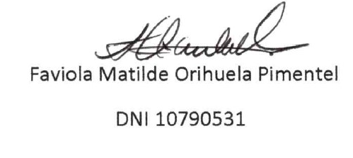
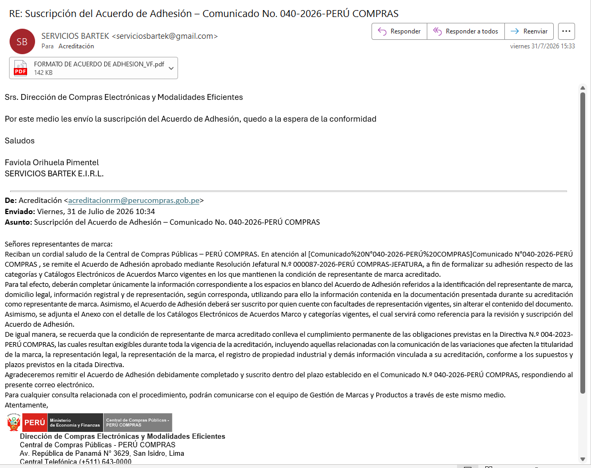
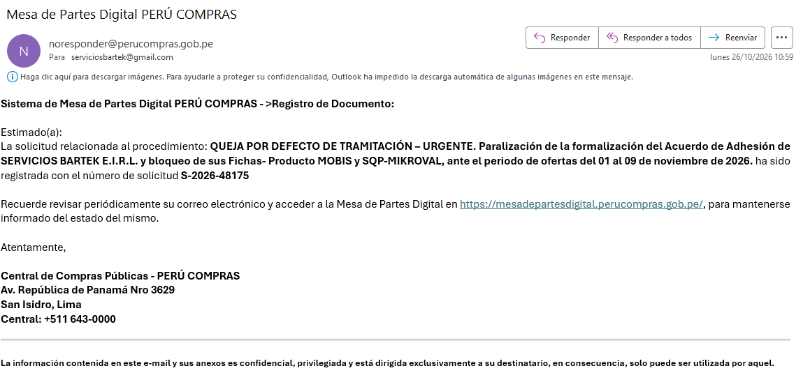
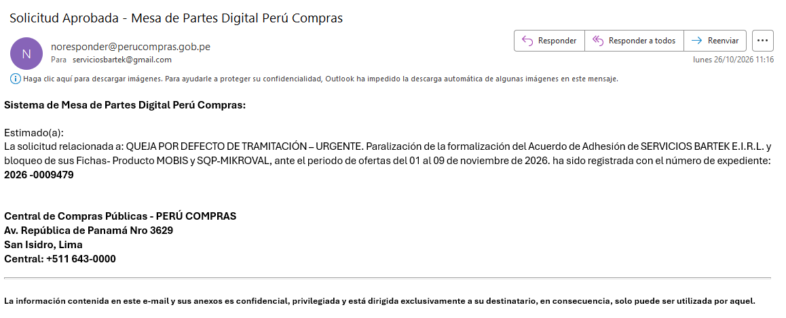

Lima, 03 de noviembre de 2026

**CARTA N.° 03112026-1-SERVICIOS BARTEK E.I.R.L.**

Señor(a)
**JEFE(A) DEL ÓRGANO DE CONTROL INSTITUCIONAL**
Central de Compras Públicas – **PERÚ COMPRAS**
Av. República de Panamá N.° 3629, San Isidro, Lima
Presente.–

**ASUNTO:** SOLICITUD DE INTERVENCIÓN URGENTE – Queja por defecto de tramitación **no resuelta** (Exp. N.° 2026-0009479) y paralización de la formalización del Acuerdo de Adhesión de SERVICIOS BARTEK E.I.R.L., durante el periodo de ofertas del 01 al 09 de noviembre de 2026.

**REFERENCIAS:**

a) Carta N.° 26102026-1-SERVICIOS BARTEK E.I.R.L. (queja por defecto de tramitación) – Solicitud **S-2026-48175**, **Exp. N.° 2026-0009479**, del 26/10/2026.
b) Carta N.° 16102026-1-SERVICIOS BARTEK E.I.R.L., del 16/10/2026.
c) Reclamo en el Libro de Reclamaciones, código **pp4c2lqjm**, del 07/10/2026, y Memorando N.° 001922-2026-PERÚ COMPRAS-DCEME, del 29/10/2026.

De nuestra consideración:

**SERVICIOS BARTEK E.I.R.L.**, con RUC N.° **20610900551**, representada por su Gerente, **FAVIOLA MATILDE ORIHUELA PIMENTEL**, identificada con DNI N.° **10790531**, pone en conocimiento de su despacho los siguientes hechos, para que, en el marco de sus competencias, **evalúe las acciones de control** que correspondan.

**1.** El **31/07/2026 a las 10:34**, la Dirección de Compras Electrónicas y Modalidades Eficientes (**DCEME**) nos remitió el Acuerdo de Adhesión, y **ese mismo día, a las 15:33**, lo devolvimos **suscrito**, dentro del plazo del Comunicado N.° 040-2026-PERÚ COMPRAS (Anexo 1). Luego atendimos las subsanaciones requeridas; según el Memorando N.° 001922-2026-PERÚ COMPRAS-DCEME, la documentación quedó completa el **14/09/2026**. La propia DCEME reconoce, en su correo del 16/10/2026 y en dicho memorando, que nuestra empresa **cumplió con presentar el Acuerdo de Adhesión** y que su formalización está **pendiente por parte de PERÚ COMPRAS**. Aun contando desde el 14/09/2026, el plazo máximo de **treinta (30) días hábiles** del **artículo 39 del TUO de la Ley N.° 27444** **venció el 27/10/2026**. Mientras tanto, nuestras **22 Fichas-Producto MOBIS** en estado OFERTADO no están habilitadas para los proveedores, y nuestras **3 fichas SQP-MIKROVAL** no pueden subsanarse.

**2.** Según el **listado oficial** publicado por PERÚ COMPRAS, actualizado al 22/10/2026, la Entidad **ya formalizó el acuerdo de 24 representantes de marca** del Catálogo de Mobiliario en General y de **5** de la categoría Desinfectantes, en las mismas categorías que la nuestra. **El nuestro no.**

**3.** El **26/10/2026** presentamos **queja por defecto de tramitación** ante la Jefatura (Exp. N.° 2026-0009479). Conforme al **artículo 169.2 del TUO de la Ley N.° 27444**, debía resolverse **dentro de los tres (3) días hábiles**, es decir, **hasta el 29/10/2026**. **A la fecha no ha sido resuelta.**

**4.** El periodo de presentación de ofertas de los proveedores **ya comenzó (01 al 09 de noviembre de 2026)** y nuestras fichas **siguen sin estar habilitadas**. Cada día que pasa es un perjuicio directo para nuestra empresa y una restricción a la libre concurrencia en el catálogo.

**SOLICITAMOS** a su despacho que:

1. **Evalúe las acciones de control o preventivas** que correspondan ante la **falta de resolución de la queja** dentro del plazo legal y la **paralización** del trámite de formalización de nuestro Acuerdo de Adhesión.
2. **Verifique** el criterio seguido por la DCEME para formalizar los Acuerdos de Adhesión de otros representantes de marca del mismo catálogo y no el nuestro.
3. Nos **informe** el número de registro y el estado de la presente.

Atentamente,

{width=4.8cm}

**SERVICIOS BARTEK E.I.R.L.** – RUC N.° 20610900551 · Correo: serviciosbartek@gmail.com

**ANEXOS:**

- **Anexo 1:** Envío del Acuerdo de Adhesión suscrito (31/07/2026), registro de la queja (S-2026-48175) y número de expediente (2026-0009479).
- **Anexo 2:** Carta N.° 26102026-1 (queja), con sus anexos.

```{=openxml}
<w:p><w:r><w:br w:type="page"/></w:r></w:p>
```

**ANEXO 1 – Envío del Acuerdo de Adhesión suscrito (31/07/2026)**

{width=15.5cm}

```{=openxml}
<w:p><w:r><w:br w:type="page"/></w:r></w:p>
```

**ANEXO 1 (cont.) – Registro de la queja y número de expediente**

{width=15cm}

{width=15cm}
