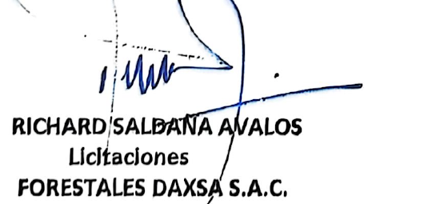
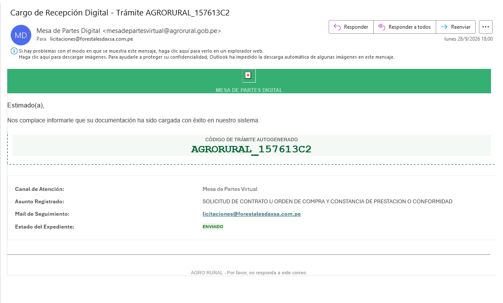
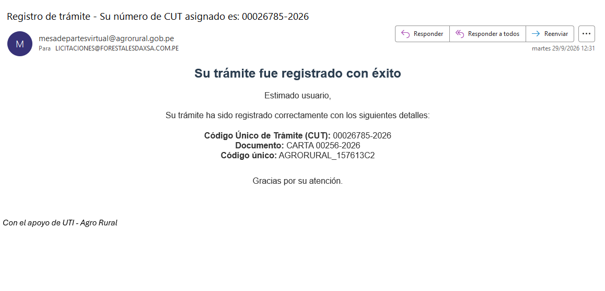

Trujillo, 26 de octubre de 2026

**CARTA N.° 26102026-FORESTALES DAXSA S.A.C.**

Señor
**CPC EMERSON INCA HUAMÁN**
Jefe de la Sub Unidad de Abastecimiento
Programa de Desarrollo Productivo Agrario Rural – **AGRO RURAL**
Jr. Cahuide N.° 805, Jesús María, Lima
Presente.–

**ASUNTO:** REITERAMOS SOLICITUD de copia del contrato u orden de compra y de la **constancia de prestación** – Contratación directa *"Adquisición de Rollizos de Madera para el Kit para la Protección y Uso Sostenible de Bofedales"* (D.U. N.° 030-2023).

**REFERENCIAS:**

a) Carta N.° 00256-2026-FORESTALES DAXSA S.A.C., del 25 de septiembre de 2026 – Código **AGRORURAL_157613C2**, **CUT N.° 00026785-2026** (presentada el 28/09/2026 y registrada el 29/09/2026).
b) Carta N.° 420-2023-MIDAGRI-DVDAFIR-AGRORURAL-DE/UA, del 08 de septiembre de 2023 (adjudicación por contratación directa).

---

De nuestra consideración:

**FORESTALES DAXSA S.A.C.** se dirige a usted para **reiterar** la solicitud de la referencia a), que **no ha sido atendida** pese a haber transcurrido casi un mes desde su presentación.

**1. Lo que solicitamos**

Mediante la Carta N.° 420-2023-MIDAGRI-DVDAFIR-AGRORURAL-DE/UA, AGRO RURAL adjudicó a nuestra empresa, por contratación directa, la *"Adquisición de Rollizos de Madera para el Kit para la Protección y Uso Sostenible de Bofedales"*, en los ítems de Apurímac, Arequipa, Ayacucho, Cusco, Junín, Puno y Tacna. Respecto de esa contratación, solicitamos:

1. **Copia del contrato y/o de la(s) orden(es) de compra** emitidas a favor de FORESTALES DAXSA S.A.C.
2. **La constancia de prestación** o, en su defecto, **la conformidad** de la prestación.

**2. Fundamento**

**2.1. La constancia de prestación es una obligación de la Entidad.** El **numeral 169.1 del artículo 169 del Reglamento de la Ley N.° 30225**, aprobado por Decreto Supremo N.° 344-2018-EF, aplicable a esta contratación, dispone que, otorgada la conformidad, el órgano de administración o el funcionario designado **emite la constancia de prestación**, que debe precisar, como mínimo, la identificación del contrato, el objeto, el monto vigente, el plazo y las penalidades, de ser el caso. Esta constancia es el documento con el que los contratistas **acreditamos nuestra experiencia** en los procedimientos de selección.

**2.2. La copia del contrato u orden de compra es información pública.** Conforme al **TUO de la Ley N.° 27806, Ley de Transparencia y Acceso a la Información Pública**, aprobado por Decreto Supremo N.° 021-2019-JUS, la información sobre las contrataciones de la Entidad es pública y debe entregarse en un plazo **no mayor de diez (10) días hábiles** (literal b del artículo 11). **Formulamos expresamente este pedido de acceso a la información pública** y solicitamos que se derive al funcionario responsable, de corresponder.

**2.3. El plazo obliga a la Administración.** El **artículo 142 del TUO de la Ley N.° 27444** establece que los plazos son máximos y obligan por igual a la Administración y a los administrados. Nuestra solicitud también se ampara en el **derecho de petición** (artículo 2, inciso 20 de la Constitución).

**3. Petitorio**

Solicitamos que, en un plazo **no mayor de diez (10) días hábiles**, se nos remita al correo **licitaciones@forestalesdaxsa.com.pe**:

1. Copia del **contrato y/o orden(es) de compra**.
2. La **constancia de prestación**, emitida conforme al artículo 169 del Reglamento, y su **registro en el SEACE**.
3. Si la constancia no puede emitirse, **el motivo por escrito** y, en ese caso, copia de la **conformidad** de la prestación.

De no recibir respuesta, presentaremos **queja por defecto de tramitación** ante el superior jerárquico (artículo 169 del TUO de la Ley N.° 27444) y el **recurso de apelación** ante el **Tribunal de Transparencia y Acceso a la Información Pública**.

Atentamente,

{width=5.5cm}

Domicilio: Lote B Predio Huartaco U.C. 03247-P – Moche – Trujillo – La Libertad
Correo: licitaciones@forestalesdaxsa.com.pe · Teléfono: (044) 465375 · Celular: 988035887

**C.c.:** Jefe(a) de la Unidad de Administración de AGRO RURAL.

**ANEXOS:**

- **Anexo 1:** Cargo de recepción digital (28/09/2026) y constancia de registro del trámite (CUT N.° 00026785-2026).
- **Anexo 2:** Carta N.° 00256-2026-FORESTALES DAXSA S.A.C., con la Carta N.° 420-2023-MIDAGRI-DVDAFIR-AGRORURAL-DE/UA.

```{=openxml}
<w:p><w:r><w:br w:type="page"/></w:r></w:p>
```

**ANEXO 1 – Cargo de recepción digital (28/09/2026) y registro del trámite (29/09/2026)**

{width=14cm}

{width=14cm}
