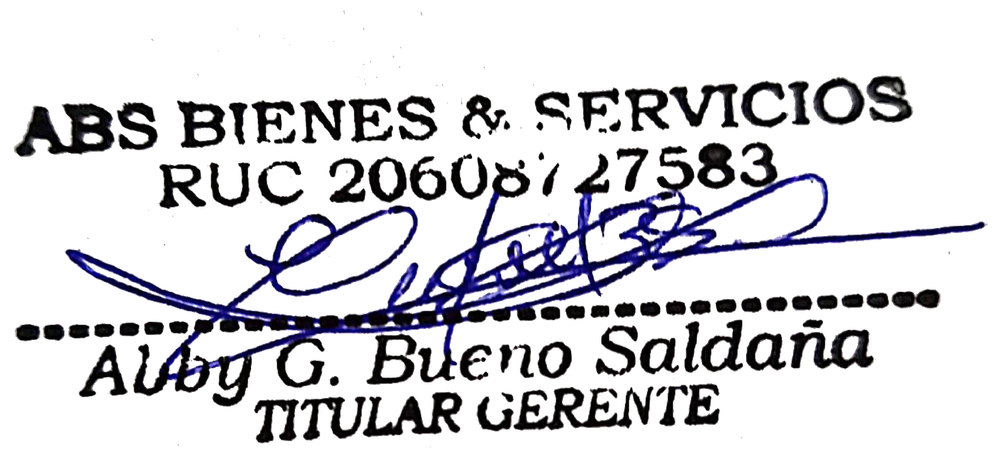

**CARTA NOTARIAL**

Lima, 24 de noviembre de 2026

**CARTA N.° 24112026-1-ABS BIENES & SERVICIOS E.I.R.L.**

Señor
**SANTIAGO YURI CANO LA ROSA**
Alcalde Provincial
**MUNICIPALIDAD PROVINCIAL DE HUAURA – HUACHO**
Calle Colón N.° 150 (Plaza de Armas), Huacho, provincia de Huaura, departamento de Lima
Presente.–

**ASUNTO:** REQUERIMIENTO NOTARIAL DE PAGO – Orden de Compra N.° 000146 / OCAM-2022-301371-25-0 y 25-1 – **S/ 5,223.39 más intereses legales**.

De mi consideración:

**ABS BIENES & SERVICIOS E.I.R.L.**, con RUC N.° **20608727583**, con domicilio en Calle Giuseppe Verdi N.° 951, Urb. Primavera, Trujillo, La Libertad, representada por su Titular Gerente, **ABBY GABRIELA BUENO SALDAÑA**, identificada con DNI N.° **48054321**, por medio de la presente carta notarial **REQUIERE FORMALMENTE** a la Municipalidad Provincial de Huaura el pago de la deuda que mantiene con nuestra empresa, por los siguientes hechos:

**1.** Mediante la **Orden de Compra N.° 000146**, del 04/07/2022, y la **OCAM-2022-301371-25-0**, formalizada el **06/07/2022** a través de los Catálogos Electrónicos de PERÚ COMPRAS, la Municipalidad nos adquirió **cuatro (4) neumáticos** por **S/ 5,223.39**.

**2.** **Entregamos los bienes el 20/07/2022** (Guía de Remisión EG01-6, con sello de recepción de la Municipalidad) y emitimos la **Factura Electrónica E001-17** por S/ 5,223.39. **Han pasado más de cuatro (4) años sin que se nos pague.**

**3.** **PERÚ COMPRAS ha verificado** en su plataforma que la orden se encuentra **"ENTREGADA C/CONFORMIDAD RETRASADA"** y ha informado el incumplimiento de la Municipalidad a su Órgano de Control Institucional (**Oficio N.° 003413-2026-PERÚ COMPRAS-DCEME**, del 21/07/2026, con copia a su despacho) y a la **Contraloría General de la República** (**Oficio N.° 006464-2026-PERÚ COMPRAS-DCEME**, del 19/10/2026, con copia a su despacho).

**4.** La **Defensoría del Pueblo** requirió a su despacho un informe sobre nuestro caso mediante el **Oficio N.° 0308-2026-DP/OD-LIMAPROV** (Exp. N.° 000304-2026). El plazo venció el 05/11/2026 **sin que tengamos respuesta**.

**5.** Nuestras cartas de los años 2023, 2024, 2025 y 2026, incluida la **Carta N.° 07102026-1** del 07/10/2026 (registrada como DOC 2621771 en el **Expediente N.° 655163**), **no han sido respondidas**.

**6.** La Municipalidad estaba obligada a pagar dentro de los diez (10) días calendario siguientes a la conformidad, **bajo responsabilidad del funcionario competente** (numeral 171.1 del artículo 171 del Reglamento de la Ley N.° 30225, aprobado por D.S. N.° 344-2018-EF). En caso de retraso, la Entidad **debe reconocer al contratista los intereses legales** correspondientes (numeral 39.4 del artículo 39 del TUO de la Ley N.° 30225). Asimismo, el **numeral 67.4 del artículo 67 de la Ley N.° 32069** califica como **falta grave** la demora injustificada en el pago y como **falta muy grave** cuando el contratista inicia acciones legales.

**EN CONSECUENCIA, REQUERIMOS** a la Municipalidad Provincial de Huaura que, en un plazo **no mayor de diez (10) días hábiles** contados desde la recepción de la presente:

1. **Pague S/ 5,223.39** mediante abono en nuestra cuenta bancaria, cuyo CCI consta en la Carta de Autorización entregada a la Municipalidad, **más los intereses legales** devengados desde la fecha en que el pago debió efectuarse hasta la fecha de pago efectivo.
2. **Informe por escrito** el destino del **giro de S/ 3,482.27** registrado el 26/01/2023 en el **Expediente SIAF N.° 3618-2022** (Documento N.° 0103), que **nuestra empresa nunca recibió**, y el sustento de la **rebaja de S/ 1,741.12** (Memorándum N.° 472-2023-OGAF), que **nunca nos fue notificada**.

**La presente constituye en mora a la Municipalidad** para todos los efectos legales (artículo 1333 del Código Civil). De no cumplirse con el pago en el plazo indicado, **iniciaremos sin más aviso las acciones legales** que correspondan para el cobro de la deuda, los intereses legales, los costos y la indemnización por daños y perjuicios, por la vía de **conciliación, arbitraje** o la que resulte aplicable, y solicitaremos la **determinación de responsabilidades** de los funcionarios a cargo ante la Contraloría General de la República.

Atentamente,

{width=6cm}

**ABBY GABRIELA BUENO SALDAÑA**
DNI N.° 48054321 · Titular Gerente
**ABS BIENES & SERVICIOS E.I.R.L.** – RUC N.° 20608727583
Correo: abs.comercial2@gmail.com · Celular: 986045123

**C.c.:**
- Oficina General de Administración y Finanzas – Municipalidad Provincial de Huaura.
- Órgano de Control Institucional – Municipalidad Provincial de Huaura.
- Defensoría del Pueblo – Oficina Defensorial de Lima Provincias (Exp. N.° 000304-2026).
